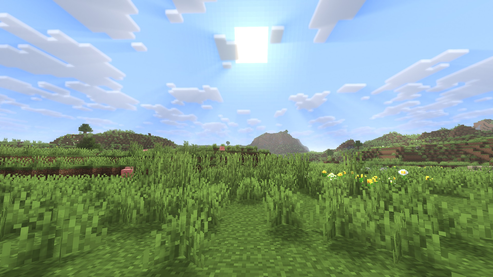
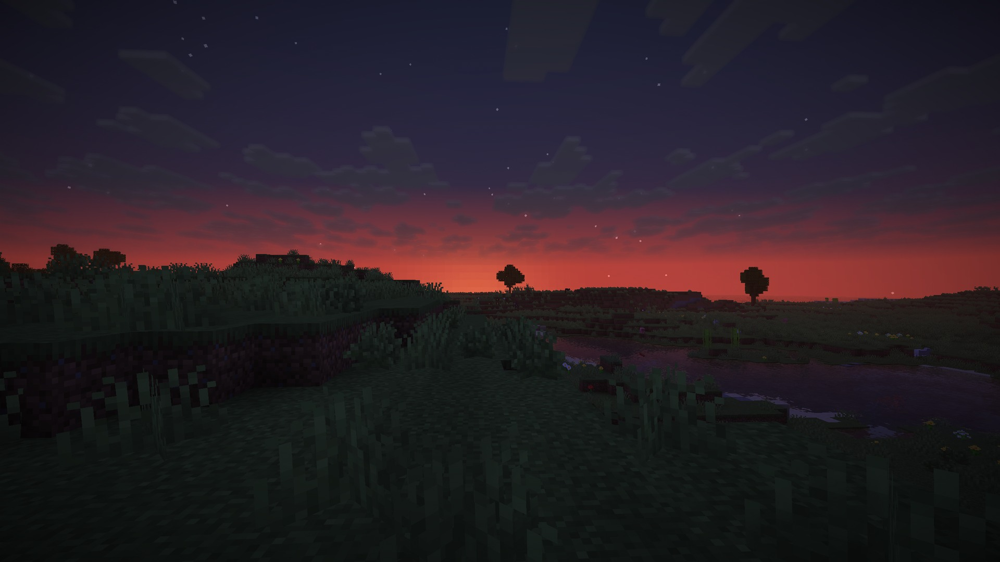
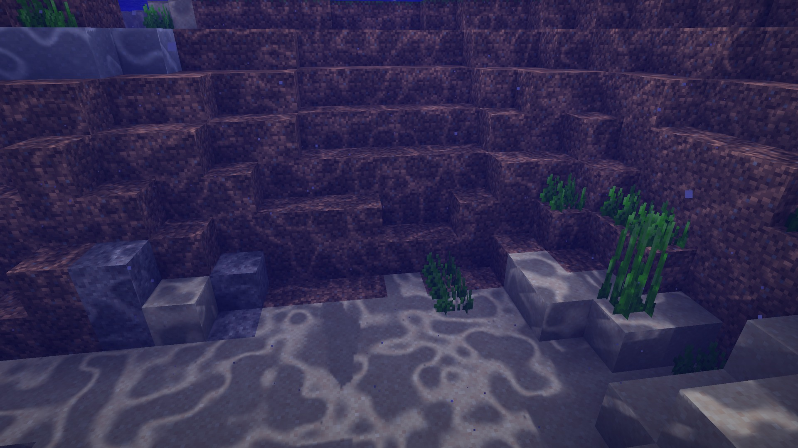
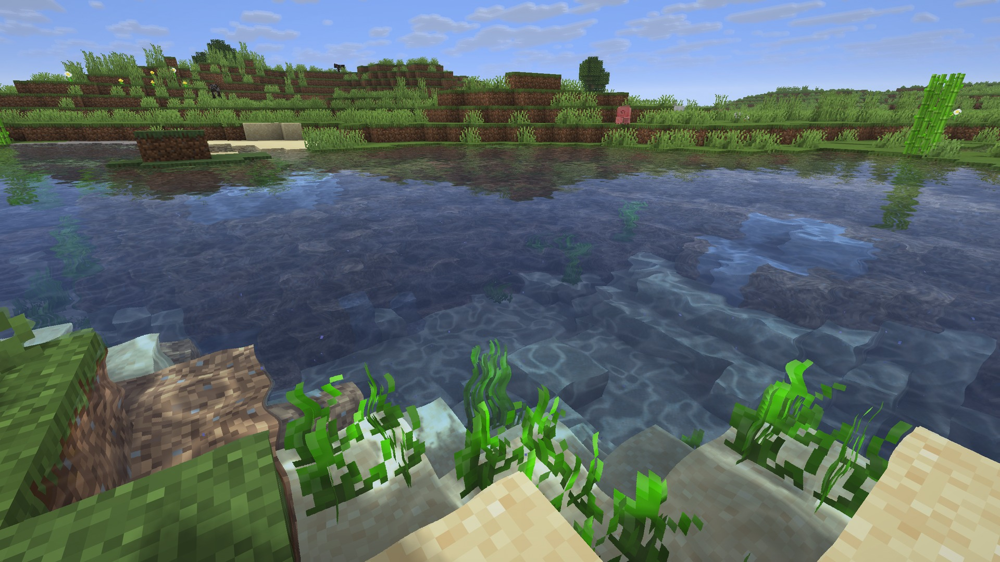
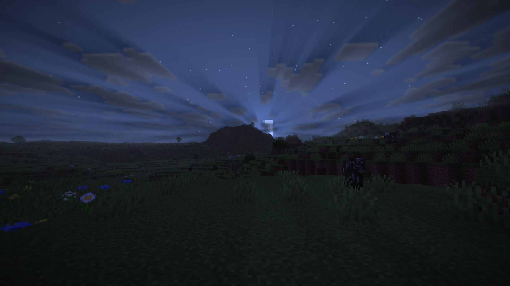
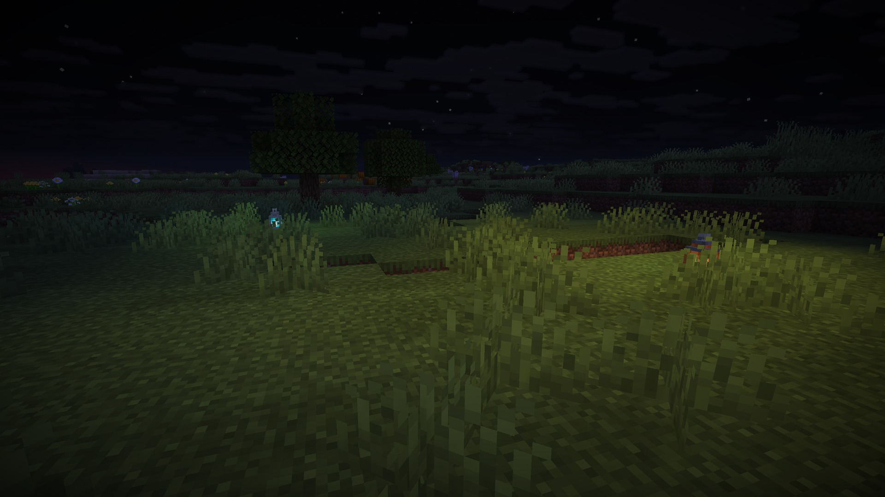
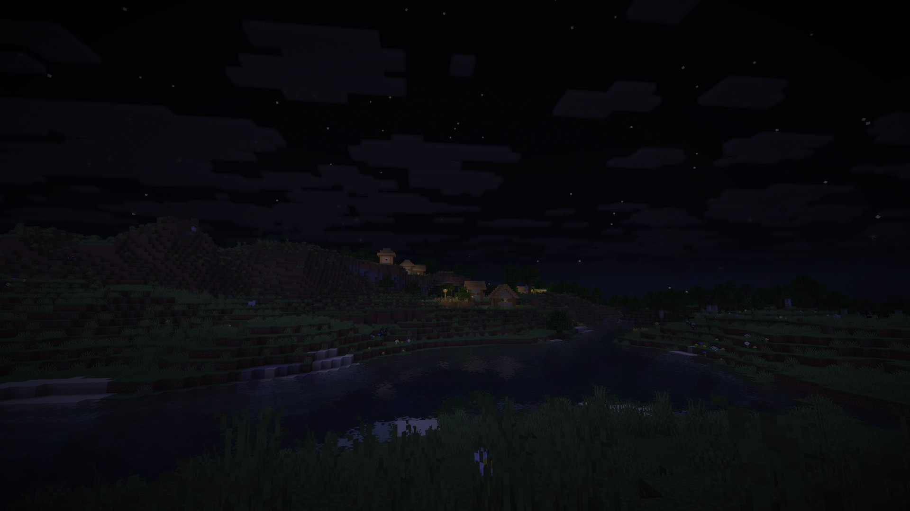
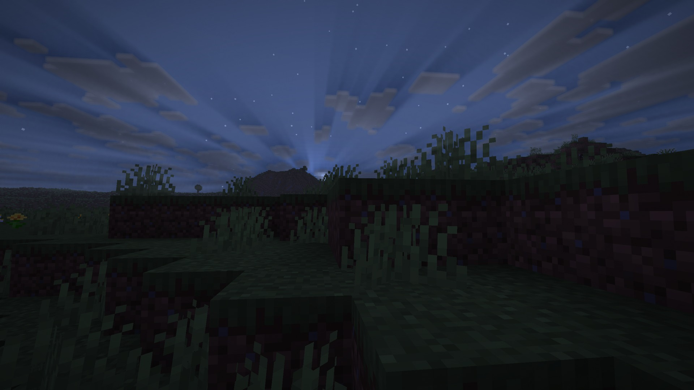

# horizon-shader

Sources of **Petalveil**, a shader pack for [Horizon](https://github.com/horizon-rust/horizon) (WGSL, shader API 0.2).


- `pack/` — the pack itself (`horizon-shaders.toml` + `.wgsl`), the folder Horizon loads.
- `.opencode/NOTES.md` — notes for agents working here (tooling, API gotchas, local loop).

## Screenshots

<table>
<tr>
<td align="center"><br><sub>Pastel day sky, vanilla's clouds, waving grass</sub></td>
<td align="center"><br><sub>Sunset veil and glow</sub></td>
</tr>
<tr>
<td align="center"><br><sub>Caustics on the blocks under water</sub></td>
<td align="center"><br><sub>Waves, depth shading and the sky's mirror</sub></td>
</tr>
<tr>
<td align="center"><br><sub>Moon rays and moon shadows</sub></td>
<td align="center"><br><sub>Vanilla's light kept: torches light the grass as before</sub></td>
</tr>
<tr>
<td align="center"><br><sub>Night mood, the mirror on a calm river</sub></td>
<td align="center"><br><sub>Moon low over the hills</sub></td>
</tr>
</table>

## Check and package

CI runs the same check on every push and packages a `.hshader` artifact (`.github/workflows/check.yml`); a pushed
`v*` tag publishes it as a GitHub release (`.github/workflows/release.yml`), with the tag checked against the
manifest's `version`. Locally:

The checker is Horizon's own tool; it is not installed system-wide, build it once:

```sh
git clone --filter=blob:none https://github.com/horizon-rust/horizon.git /tmp/opencode/horizon
cd /tmp/opencode/horizon && cargo build -p horizon-shader-api --bin horizon-shader
```

Then, from this folder:

```sh
/tmp/opencode/horizon/target/debug/horizon-shader check pack
/tmp/opencode/horizon/target/debug/horizon-shader pack pack --out petalveil-2.0.0.hshader
```

## Live in the game

`pack/` is symlinked into the instance's `shaderpacks/`, and Horizon reloads a pack within half a second of every
save: edit, save, look. Pick it on **Options > Horizon Settings > Shader Packs**.

```sh
ln -sfn "$PWD/pack" ~/.local/share/horizon/shaderpacks/petalveil
horizon-launcher packs on --kind shader "Petalveil"
```
